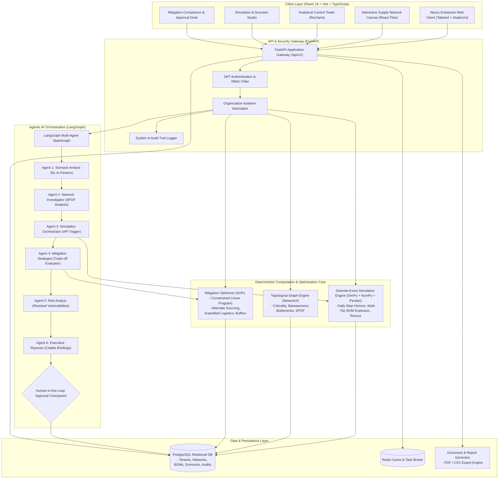

# NEXUS: AI Supply Network Intelligence & Disruption Simulator
## Architectural Blueprint & System Specification

---

## A. Complete System Architecture

NEXUS is an enterprise-grade multi-tenant B2B SaaS platform engineered for supply chain directors, procurement executives, and risk operations teams. The system enables organizations to map multi-tier global supply topologies (Tier 3 raw material extraction through Tier 0 production facilities and downstream logistics hubs), model structural network vulnerabilities, run deterministic discrete-event disruption simulations, calculate cascading financial and operational impacts, optimize mitigation strategies, and orchestrate verifiable multi-agent AI analysis governed by human-in-the-loop approvals.

### Core Architectural Tenets
1. **Deterministic Core Principle**: All quantitative computations—production delays, inventory runout timelines, capacity utilization, lead time shifts, customer backlog, lost revenue, and mitigation costs—are calculated strictly by deterministic mathematical and discrete-event simulation engines (NetworkX, SimPy, NumPy, Pandas, SciPy). Large Language Models (LLMs) **never fabricate or alter numerical figures**.
2. **Citable Verification Trail**: AI agents receive typed state outputs containing deterministic simulation hashes and UUIDs. All agent assertions and executive narratives must cite explicit metric identifiers and simulation references.
3. **Strict Multi-Tenant Isolation**: Complete database partition by `organization_id` on every query, model relationship, scenario, and simulation artifact. Role-Based Access Control (RBAC) enforces granular permissions across six distinct enterprise tiers.
4. **Human-in-the-Loop Governance**: No mitigation recommendation or sourcing reallocation can be pushed to operational state or ERP connectors without explicit human review, rationale documentation, and immutable audit logging.

---

## B. System Architecture Diagram



---

## C. Project Directory Structure

```
nexus/
├── backend/
│   ├── app/
│   │   ├── __init__.py
│   │   ├── main.py                  # FastAPI application bootstrap & lifespan
│   │   ├── config.py                # Pydantic BaseSettings configuration
│   │   ├── database.py              # SQLAlchemy engine, session maker, base model
│   │   ├── models/                  # SQLAlchemy ORM declarative models
│   │   │   ├── __init__.py
│   │   │   ├── tenant.py            # Organization, Membership, Role definitions
│   │   │   ├── user.py              # User account, Auth credentials, Tokens
│   │   │   ├── supply_network.py    # Supplier, Facility, Product, Material, BOM, SupplyEdge
│   │   │   ├── scenario.py          # DisruptionScenario, DisruptionEvent
│   │   │   ├── simulation.py        # SimulationRun, DailyMetricRecord, ProductImpact
│   │   │   ├── mitigation.py        # MitigationPlan, SourcingAlternative, CostBenefit
│   │   │   ├── approval.py          # ApprovalRequest, DecisionAudit
│   │   │   └── audit.py             # SystemAuditLog
│   │   ├── schemas/                 # Pydantic V2 Request & Response schemas
│   │   │   ├── __init__.py
│   │   │   ├── auth.py
│   │   │   ├── tenant.py
│   │   │   ├── network.py
│   │   │   ├── scenario.py
│   │   │   ├── simulation.py
│   │   │   ├── mitigation.py
│   │   │   ├── agents.py
│   │   │   └── reports.py
│   │   ├── api/                     # API routers and dependency injection
│   │   │   ├── __init__.py
│   │   │   ├── deps.py              # Current user, Current organization, RBAC checks
│   │   │   └── v1/
│   │   │       ├── __init__.py
│   │   │       ├── auth.py          # /login, /register, /refresh, /me
│   │   │       ├── organizations.py # /organizations, onboarding, member invites
│   │   │       ├── suppliers.py     # CRUD, CSV import/export, risk scoring
│   │   │       ├── facilities.py    # CRUD, capacity, utilization, upstream/downstream
│   │   │       ├── products.py      # Products, materials, BOM configurations
│   │   │       ├── inventory.py     # Current inventory, buffers, days-of-supply
│   │   │       ├── network.py       # Graph topology, SPOF analysis, React Flow node/edge adapter
│   │   │       ├── scenarios.py     # Scenario builder, templates, cloning, validation
│   │   │       ├── simulations.py   # Run deterministic simulation, fetch timeline, compare
│   │   │       ├── mitigations.py   # Optimize mitigation, compare trade-offs, run what-if
│   │   │       ├── agents.py        # LangGraph workflow initiation, streaming, state inspection
│   │   │       ├── approvals.py     # Human review desk: approve, reject, comment
│   │   │       ├── reports.py       # PDF/CSV executive generator
│   │   │       └── demo_seed.py     # Apex Manufacturing Group 1-click synthetic generator
│   │   ├── engine/                  # Deterministic mathematical & simulation core
│   │   │   ├── __init__.py
│   │   │   ├── graph_engine.py      # NetworkX multi-tier topology and centrality calculations
│   │   │   ├── bom_engine.py        # Multi-level Bill-of-Materials tree traversal and explosion
│   │   │   ├── simulation_engine.py # Time-step discrete-event simulation (SimPy/NumPy/Pandas)
│   │   │   ├── mitigation_optimizer.py # Optimization engine for alternate supplier allocation
│   │   │   └── synthetic_generator.py  # Apex Manufacturing Group synthetic topology generator
│   │   ├── agents/                  # LangGraph multi-agent architecture
│   │   │   ├── __init__.py
│   │   │   ├── state.py             # AgentState schema (strictly typed)
│   │   │   ├── tools.py             # Simulation & DB query tools callable by agents
│   │   │   ├── graph.py             # LangGraph state machine builder and transitions
│   │   │   ├── scenario_analyst.py  # Agent 1
│   │   │   ├── network_investigator.py # Agent 2
│   │   │   ├── simulation_orchestrator.py # Agent 3
│   │   │   ├── mitigation_strategist.py # Agent 4
│   │   │   ├── risk_analyst.py      # Agent 5
│   │   │   └── executive_reporter.py # Agent 6
│   │   └── services/
│   │       ├── __init__.py
│   │       ├── pdf_generator.py     # Clean ReportLab enterprise PDF generator
│   │       └── audit_service.py     # Audit event dispatcher
│   ├── tests/
│   │   ├── __init__.py
│   │   ├── test_auth.py
│   │   ├── test_tenant_isolation.py
│   │   ├── test_graph_engine.py
│   │   ├── test_simulation_engine.py
│   │   ├── test_mitigation_optimizer.py
│   │   ├── test_agent_graph.py
│   │   └── test_api_endpoints.py
│   ├── requirements.txt
│   └── Dockerfile
├── frontend/
│   ├── src/
│   │   ├── api/                     # Axios/Fetch API client bindings
│   │   │   ├── client.ts
│   │   │   ├── auth.ts
│   │   │   ├── network.ts
│   │   │   ├── scenarios.ts
│   │   │   ├── simulations.ts
│   │   │   ├── mitigations.ts
│   │   │   ├── agents.ts
│   │   │   ├── approvals.ts
│   │   │   └── reports.ts
│   │   ├── components/
│   │   │   ├── layout/              # AppLayout, Dark Navy Sidebar, Header, Breadcrumbs
│   │   │   ├── ui/                  # Button, Card, Badge, Modal, Tabs, Table, MetricCard
│   │   │   ├── network/             # React Flow custom nodes (SupplierNode, FacilityNode, etc.)
│   │   │   ├── charts/              # Recharts wrapper components (ImpactTimeline, RiskRadar)
│   │   │   └── common/              # StatusPills, EmptyStates, SyntheticBadge
│   │   ├── contexts/
│   │   │   └── AuthContext.tsx      # Auth session, token storage, active org
│   │   ├── pages/
│   │   │   ├── Overview.tsx         # Executive dashboard with KPI cards and alert feeds
│   │   │   ├── SupplyNetwork.tsx    # React Flow interactive network map + Table view
│   │   │   ├── Suppliers.tsx        # Supplier management & risk profiling
│   │   │   ├── Facilities.tsx       # Plants, warehouses, DC tracking
│   │   │   ├── Inventory.tsx        # Part inventory, safety buffers, days-of-supply
│   │   │   ├── DisruptionScenarios.tsx # Scenario builder & disruption event manager
│   │   │   ├── SimulationLab.tsx    # Deterministic simulation runner & timeline graphs
│   │   │   ├── MitigationPlanner.tsx# Strategy optimizer, trade-off frontier, what-if
│   │   │   ├── AiInsights.tsx       # LangGraph multi-agent execution & chat interface
│   │   │   ├── Reports.tsx          # PDF & CSV executive reports download center
│   │   │   ├── Approvals.tsx        # Human-in-the-loop governance desk
│   │   │   ├── Settings.tsx         # Organization profile, member roles, audit logs
│   │   │   ├── Login.tsx            # Enterprise sign-in
│   │   │   └── Register.tsx         # Organization onboarding & registration
│   │   ├── types/                   # TypeScript domain interfaces
│   │   ├── App.tsx                  # React Router configuration
│   │   ├── main.tsx                 # DOM entry point
│   │   └── index.css                # Tailwind base styles and theme
│   ├── package.json
│   ├── tsconfig.json
│   ├── vite.config.ts
│   └── tailwind.config.js
├── docker-compose.yml
└── README.md
```

---

## D. Database Entity-Relationship Diagram

```mermaid
erDiagram
    ORGANIZATIONS ||--o{ USERS : "employs"
    ORGANIZATIONS ||--o{ SUPPLIERS : "contracts"
    ORGANIZATIONS ||--o{ FACILITIES : "operates"
    ORGANIZATIONS ||--o{ PRODUCTS : "produces"
    ORGANIZATIONS ||--o{ MATERIALS : "catalogs"
    ORGANIZATIONS ||--o{ SCENARIOS : "defines"
    ORGANIZATIONS ||--o{ APPROVALS : "governs"
    ORGANIZATIONS ||--o{ AUDIT_LOGS : "records"

    USERS ||--o{ APPROVALS : "reviews"
    USERS ||--o{ AUDIT_LOGS : "acts"

    MATERIALS ||--o{ BILL_OF_MATERIALS : "specified_in"
    PRODUCTS ||--o{ BILL_OF_MATERIALS : "requires"

    SUPPLIERS ||--o{ SUPPLY_EDGES : "sources"
    FACILITIES ||--o{ SUPPLY_EDGES : "receives"
    MATERIALS ||--o{ SUPPLY_EDGES : "transported"

    FACILITIES ||--o{ INVENTORY : "stores"
    MATERIALS ||--o{ INVENTORY : "held_as"

    SCENARIOS ||--o{ DISRUPTION_EVENTS : "contains"
    SCENARIOS ||--o{ SIMULATION_RUNS : "executes"

    SIMULATION_RUNS ||--o{ SIMULATION_METRICS : "produces_daily"
    SIMULATION_RUNS ||--o{ PRODUCT_IMPACTS : "computes"
    SIMULATION_RUNS ||--o{ MITIGATION_PLANS : "analyzed_by"

    MITIGATION_PLANS ||--o{ APPROVALS : "submitted_for"

    ORGANIZATIONS {
        uuid id PK
        string name
        string slug
        string industry
        string plan_tier
        datetime created_at
    }

    USERS {
        uuid id PK
        uuid organization_id FK
        string email
        string hashed_password
        string full_name
        string role "SuperAdmin | OrgAdmin | SupplyChainManager | ProcurementManager | OperationsAnalyst | Executive"
        boolean is_active
        datetime created_at
    }

    SUPPLIERS {
        uuid id PK
        uuid organization_id FK
        string name
        string tier "Tier 1 | Tier 2 | Tier 3"
        string country
        string city
        float daily_capacity
        float current_utilization
        int lead_time_days
        float unit_cost
        float reliability_score
        float financial_risk
        float operational_risk
        string status "ACTIVE | DISRUPTED | RESTRICTED"
        boolean is_synthetic
    }

    FACILITIES {
        uuid id PK
        uuid organization_id FK
        string name
        string facility_type "PLANT | WAREHOUSE | DISTRIBUTION_CENTER | LOGISTICS_HUB"
        string country
        string city
        float daily_production_capacity
        float current_utilization
        string operating_status "NORMAL | DEGRADED | SHUTDOWN"
    }

    MATERIALS {
        uuid id PK
        uuid organization_id FK
        string sku
        string name
        string category
        float standard_cost
        string unit_of_measure
    }

    PRODUCTS {
        uuid id PK
        uuid organization_id FK
        string sku
        string name
        float selling_price
        float daily_target_demand
    }

    BILL_OF_MATERIALS {
        uuid id PK
        uuid product_id FK
        uuid material_id FK
        float quantity_required
    }

    INVENTORY {
        uuid id PK
        uuid facility_id FK
        uuid material_id FK
        float quantity_on_hand
        float safety_stock_threshold
        float reorder_point
    }

    SCENARIOS {
        uuid id PK
        uuid organization_id FK
        string name
        string description
        int simulation_horizon_days
        string status
    }

    DISRUPTION_EVENTS {
        uuid id PK
        uuid scenario_id FK
        string entity_type "SUPPLIER | FACILITY | LOGISTICS_CORRIDOR"
        uuid entity_id
        string disruption_type "SHUTDOWN | CAPACITY_REDUCTION | PORT_CLOSURE | LEAD_TIME_SURGE"
        int start_day
        int duration_days
        float capacity_reduction_pct
        int extra_lead_time_days
    }

    SIMULATION_RUNS {
        uuid id PK
        uuid scenario_id FK
        string status
        float total_revenue_loss
        float total_units_lost
        int max_delivery_delay_days
        float network_resilience_score
        jsonb metadata
        datetime executed_at
    }

    MITIGATION_PLANS {
        uuid id PK
        uuid simulation_run_id FK
        string strategy_name
        float additional_cost
        float production_recovered_pct
        float avoided_loss
        int recovery_days
        string status "DRAFT | SUBMITTED | APPROVED | REJECTED"
    }

    APPROVALS {
        uuid id PK
        uuid organization_id FK
        uuid mitigation_plan_id FK
        uuid requested_by_user_id FK
        uuid reviewed_by_user_id FK
        string status "PENDING | APPROVED | REJECTED | REVISION_REQUESTED"
        text reviewer_comments
        datetime decided_at
    }
```



---

## E. Agent Workflow Diagram (LangGraph)

```mermaid
stateDiagram-v2
    [*] --> ScenarioAnalyst : Natural Language User Prompt

    state ScenarioAnalyst {
        [*] --> ParseIntent
        ParseIntent --> ValidateParameters
        ValidateParameters --> CheckCompleteness
    }

    ScenarioAnalyst --> NetworkInvestigator : Validated Disruption Parameters
    ScenarioAnalyst --> [*] : Missing Parameters (Clarification Asked)

    state NetworkInvestigator {
        [*] --> QueryDependencyGraph
        QueryDependencyGraph --> IdentifySPOF
        IdentifySPOF --> TraceDownstreamFacilities
    }

    NetworkInvestigator --> SimulationOrchestrator : Topology & Target Entities

    state SimulationOrchestrator {
        [*] --> CallDeterministicAPI
        CallDeterministicAPI --> AwaitSimulationResult
        AwaitSimulationResult --> VerifyOutputIntegrity
    }

    SimulationOrchestrator --> MitigationStrategist : Verified Simulation Metrics

    state MitigationStrategist {
        [*] --> QueryAlternativeSuppliers
        QueryAlternativeSuppliers --> RunOptimizationProgram
        RunOptimizationProgram --> CalculateTradeOffs
    }

    MitigationStrategist --> RiskAnalyst : Evaluated Mitigation Options

    state RiskAnalyst {
        [*] --> CheckResidualVulnerabilities
        CheckResidualVulnerabilities --> AuditAssumptions
        AuditAssumptions --> FlagInputLimitations
    }

    RiskAnalyst --> ExecutiveReporter : Synthesized Technical Intelligence

    state ExecutiveReporter {
        [*] --> GenerateCitations
        GenerateCitations --> DraftExecutiveBriefing
        DraftExecutiveBriefing --> PrepareApprovalRequest
    }

    ExecutiveReporter --> HumanApprovalGate : Formal Recommendation & Evidence

    state HumanApprovalGate {
        [*] --> PendingReview
        PendingReview --> DecisionLogged : Reviewer Approves / Rejects / Requests Revision
    }

    HumanApprovalGate --> [*] : Immutable Audit Trail Created
```



---

## F. Simulation Methodology & Mathematical Formulations

The NEXUS deterministic simulation engine operates across discrete daily time-steps $t \in [1, T]$ over a planning horizon $T$ (typically 30, 60, or 90 days).

### 1. Structural Dependency Graph
The supply chain is represented as a directed acyclic multigraph $G = (V, E)$, where $V = S \cup F \cup D \cup C$:
- $S$: Multi-tier Suppliers ($S_3$ raw material, $S_2$ component, $S_1$ direct assembly)
- $F$: Manufacturing Plants
- $D$: Distribution Hubs & Warehouses
- $C$: Customer Order Aggregations
- $E$: Directed logistics and fulfillment arcs carrying material $m$, standard lead time $L_{uv}$, transit capacity $K_{uv}$, and unit transit cost $c_{uv}$.

### 2. Time-Step Material Arrival & Inventory Conservation
For facility $f \in F$ and material $m \in M$:
$$I_{f, m}(t) = I_{f, m}(t-1) + \sum_{u \in \text{Pred}(f)} Q_{u \to f, m}(t - L_{uv}(t)) - C_{f, m}(t)$$
Where:
- $I_{f, m}(t)$ is inventory on hand at day $t$.
- $Q_{u \to f, m}(\tau)$ is shipment quantity dispatched on day $\tau$ arriving on day $t = \tau + L_{uv}(t)$.
- $L_{uv}(t) = L_{uv}^0 + \Delta L_{uv}^{\text{disruption}}(t)$ incorporates transit disruptions and port congestion delays.
- $C_{f, m}(t)$ is actual quantity consumed in manufacturing at day $t$.

### 3. Disruption Perturbations
For entity $k$ subject to disruption event $d$:
$$K_k(t) = K_k^0 \times (1 - \alpha_k(t)) \quad \forall t \in [t_{\text{start}}, t_{\text{start}} + \text{duration}]$$
Where $K_k^0$ is nominal daily capacity and $\alpha_k(t) \in [0, 1]$ is the percentage disruption severity.

### 4. Multi-Level Bill-of-Materials (BOM) Explosion & Production Constraint
Let $B_{p, m}$ be the required quantity of material $m$ to assemble one unit of product $p$.
Target scheduled demand for product $p$ at facility $f$ on day $t$ is $D_{f, p}(t)$.
Available inventory limits maximum production:
$$P_{f, p}^{\text{feasible}}(t) = \min \left( K_f^{\text{machine}}(t), \, D_{f, p}(t) + B_{f, p}^{\text{backlog}}(t-1), \, \min_{m \in \text{BOM}(p)} \left\lfloor \frac{I_{f, m}(t-1) + A_{f, m}(t)}{B_{p, m}} \right\rfloor \right)$$
Where $A_{f, m}(t)$ are verified arrivals at day $t$.
Unfulfilled production accumulates as backlog:
$$B_{f, p}^{\text{backlog}}(t) = B_{f, p}^{\text{backlog}}(t-1) + D_{f, p}(t) - P_{f, p}^{\text{feasible}}(t)$$

### 5. Deterministic Financial Impact Quantification
$$\text{Total Loss}(T) = \sum_{t=1}^T \sum_{p} \left[ \Delta P_p^{\text{lost}}(t) \times (\text{Price}_p - \text{COGS}_p) + B_p^{\text{backlog}}(t) \times c_p^{\text{penalty}} \right] + \sum_{t=1}^T \sum_{m} I_m(t) \times h_m + C^{\text{expedite}}$$
Where:
- $\Delta P_p^{\text{lost}}(t)$ is permanent lost production volume.
- $c_p^{\text{penalty}}$ is contractual delivery delay penalty per unit-day.
- $h_m$ is inventory carrying cost.
- $C^{\text{expedite}}$ is additional logistics/sourcing premium incurred under mitigation.

---

## G. REST API Design Specifications

All routes are mounted under `/api/v1` and protected by JWT bearer authentication with organization tenant scoping.

### Authentication & Tenant Scoping
- `POST /api/v1/auth/register`: Create organization and SuperAdmin user.
- `POST /api/v1/auth/login`: Exchange credentials for JWT access token and refresh token.
- `POST /api/v1/auth/refresh`: Refresh expired access token.
- `GET /api/v1/auth/me`: Retrieve current authenticated user profile, organization, and permissions.

### Supply Network Modeling
- `GET /api/v1/network/graph`: Get complete multi-tier graph formatted for React Flow (nodes, edges, positions, risk levels).
- `GET /api/v1/network/criticality`: Get NetworkX calculated bottlenecks, betweenness centrality, and SPOFs.
- `GET /api/v1/suppliers`: Paginated supplier list with filtering (tier, country, risk score, status).
- `POST /api/v1/suppliers`: Create supplier record.
- `GET /api/v1/suppliers/{id}`: Deep dive into supplier dependencies and supplied materials.
- `PUT /api/v1/suppliers/{id}`: Update supplier parameters.
- `DELETE /api/v1/suppliers/{id}`: Soft delete supplier.
- `POST /api/v1/suppliers/import-csv`: Bulk import suppliers from CSV.
- `GET /api/v1/facilities`: Facilities list (plants, warehouses, distribution centers).
- `GET /api/v1/products`: Products, BOM specifications, and unit economics.
- `GET /api/v1/inventory`: Inventory levels, safety stock thresholds, and stockout projections.

### Disruption Scenarios & Simulation
- `GET /api/v1/scenarios`: List all defined scenarios and disruption templates.
- `POST /api/v1/scenarios`: Create new what-if scenario with multi-event disruption timeline.
- `POST /api/v1/scenarios/{id}/duplicate`: Clone scenario for what-if branching.
- `POST /api/v1/simulations/run`: Trigger deterministic discrete-event simulation job.
- `GET /api/v1/simulations/{id}`: Fetch simulation results (daily metrics, revenue loss, stockout day, recovery duration).
- `POST /api/v1/simulations/compare`: Compare multiple simulation runs (e.g. baseline vs. disrupted vs. mitigated).

### Mitigation & Optimization
- `POST /api/v1/mitigations/optimize`: Run optimization algorithm to evaluate alternate suppliers, buffer shifts, and expedited routes.
- `GET /api/v1/mitigations/{id}`: Retrieve cost-benefit trade-off curves and feasibility report.

### Agentic AI & Governance
- `POST /api/v1/agents/investigate`: Run LangGraph multi-agent investigation workflow on a scenario.
- `GET /api/v1/agents/traces/{execution_id}`: Inspect agent reasoning steps and verified tool citations.
- `GET /api/v1/approvals`: List pending approval requests for mitigation recommendations.
- `POST /api/v1/approvals/{id}/decide`: Record human approval or rejection with reviewer comments and audit hash.

### Reports & Synthetic Seed
- `GET /api/v1/reports/pdf/{simulation_id}`: Download publication-grade executive PDF report.
- `GET /api/v1/reports/csv/{simulation_id}`: Export full time-step simulation data in CSV format.
- `POST /api/v1/demo/seed`: 1-click synthetic generator for Apex Manufacturing Group.

---

## H. Phase-Wise Implementation Roadmap

- **Phase 1: Architecture, Multi-Tenant Database, Authentication, & Frontend Shell**
  - Setup Python backend with FastAPI, SQLAlchemy 2.0, Pydantic V2, Alembic, SQLite/PostgreSQL.
  - Setup React 18, TypeScript, Vite, Tailwind CSS, shadcn-inspired component system.
  - Establish multi-tenant data models, JWT auth, RBAC middleware, and dark navy enterprise sidebar shell.
- **Phase 2: Supply Network Core, Graph Modeling, & Interactive Canvas**
  - Implement NetworkX topological engine (centrality, bottlenecks, SPOF detection).
  - Build React Flow multi-tier canvas (Tiers 3 to 0, DC, Customer nodes with real-time risk indicators).
  - Implement full Supplier, Facility, Product, and Inventory CRUD with CSV support.
  - Generate the complete synthetic Apex Manufacturing Group dataset (30 suppliers, 5 plants, BOMs, orders).
- **Phase 3: Deterministic Simulation Engine & Scenario Studio**
  - Build time-step discrete-event engine (SimPy, NumPy, Pandas) tracking multi-level BOM explosion and inventory runout.
  - Build Disruption Scenario Builder supporting multi-event perturbations.
  - Create Simulation Lab UI with baseline-vs-disrupted comparison graphs and financial impact tallies.
- **Phase 4: Mitigation Optimization, LangGraph Multi-Agent System, & Human Governance**
  - Implement mathematical optimization engine for alternate supplier allocation and capacity reallocation.
  - Implement LangGraph multi-agent orchestration (6 specialized agents with strict deterministic tool calling).
  - Build Human-in-the-Loop Approval Desk with immutable audit logging.
- **Phase 5: Scenario Comparison, Executive Reports, & System Hardening**
  - Implement multi-scenario side-by-side comparison analytics.
  - Build downloadable executive PDF and CSV report generator (ReportLab).
  - Complete full unit and integration test suites covering simulation reproducibility, tenant isolation, and RBAC.
- **Phase 6: Dockerization, Production Polish, & Demonstration Readiness**
  - Docker Compose configuration, production deployment docs, and end-to-end verification.
